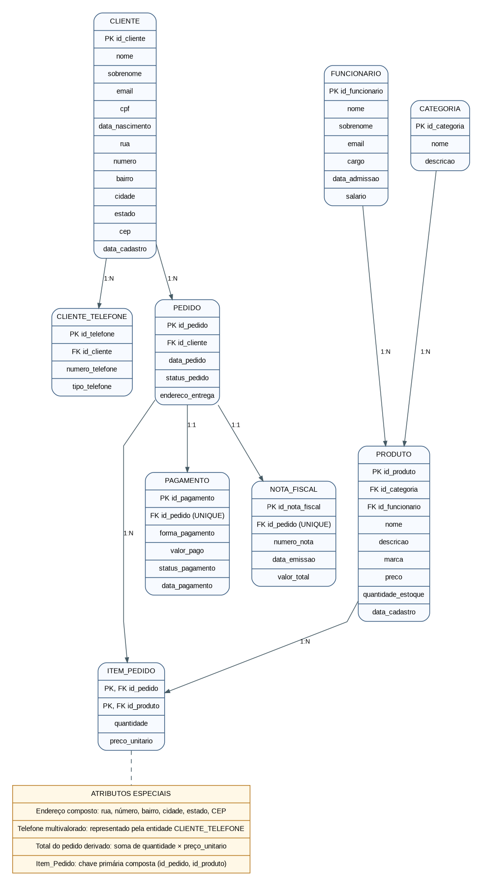

# GameTech Informática

**Projeto final de Modelagem de Banco de Dados — FATEC**  
**Tecnologias:** PostgreSQL, Supabase, SQL e GitHub.

Este repositório apresenta a modelagem e a implementação de um banco de dados relacional para uma loja fictícia de informática e acessórios gamer. O projeto contempla nove tabelas, diagrama entidade-relacionamento, criação física em SQL, população de dados, operações CRUD e dez consultas para relatórios.

## 1. Cenário

### 1.1 Descrição da empresa

A **GameTech Informática** é uma empresa fictícia especializada na venda de componentes de computadores e acessórios gamer, como processadores, placas de vídeo, memórias RAM, placas-mãe, SSDs, monitores, teclados, mouses e headsets. A empresa atende clientes interessados em montar, atualizar ou realizar manutenção em seus computadores.

### 1.2 Problema identificado

Sem um banco de dados centralizado, a loja pode enfrentar dificuldades para acompanhar estoque, localizar clientes e pedidos, registrar pagamentos, emitir informações fiscais e produzir relatórios. O controle manual também favorece duplicações e inconsistências.

### 1.3 Solução proposta e objetivo

Foi desenvolvido um banco de dados relacional em **PostgreSQL**, utilizando o **Supabase**, para organizar clientes, telefones, funcionários, categorias, produtos, pedidos, itens vendidos, pagamentos e notas fiscais. O objetivo é aplicar modelagem conceitual, lógica e física, regras de integridade, inserção de dados, CRUD e consultas SQL.

### 1.4 Entidades e atributos

| Entidade | Atributos |
|---|---|
| **Cliente** | id_cliente (PK), nome, sobrenome, email, cpf, data_nascimento, rua, numero, bairro, cidade, estado, cep, data_cadastro |
| **Cliente_Telefone** | id_telefone (PK), id_cliente (FK), numero_telefone, tipo_telefone |
| **Funcionario** | id_funcionario (PK), nome, sobrenome, email, cargo, data_admissao, salario |
| **Categoria** | id_categoria (PK), nome, descricao |
| **Produto** | id_produto (PK), id_categoria (FK), id_funcionario (FK), nome, descricao, marca, preco, quantidade_estoque, data_cadastro |
| **Pedido** | id_pedido (PK), id_cliente (FK), data_pedido, status_pedido, endereco_entrega |
| **Item_Pedido** | id_pedido (PK/FK), id_produto (PK/FK), quantidade, preco_unitario |
| **Pagamento** | id_pagamento (PK), id_pedido (FK/UNIQUE), forma_pagamento, valor_pago, status_pagamento, data_pagamento |
| **Nota_Fiscal** | id_nota_fiscal (PK), id_pedido (FK/UNIQUE), numero_nota, data_emissao, valor_total |

### 1.5 Tipos de atributos

- **Simples:** nome, email, marca e preco.
- **Composto:** endereço do cliente, dividido em rua, numero, bairro, cidade, estado e cep.
- **Multivalorado:** telefone do cliente, representado pela tabela `cliente_telefone`.
- **Derivado:** valor total de um pedido, calculado pela soma de `quantidade × preco_unitario` dos itens.
- **Identificadores:** chaves primárias das entidades; em `item_pedido`, a chave primária é composta por `id_pedido` e `id_produto`.

### 1.6 Relacionamentos

| Entidades | Cardinalidade |
|---|---|
| Cliente — Pedido | 1:N |
| Cliente — Cliente_Telefone | 1:N |
| Categoria — Produto | 1:N |
| Funcionario — Produto | 1:N |
| Pedido — Item_Pedido | 1:N |
| Produto — Item_Pedido | 1:N |
| Pedido — Produto | N:N, resolvido por Item_Pedido |
| Pedido — Pagamento | 1:0..1 no esquema implementado |
| Pedido — Nota_Fiscal | 1:0..1 no esquema implementado |

### 1.7 Regras de negócio

Cada cliente possui um identificador único e pode ter vários telefones e pedidos. Cada produto pertence a uma categoria e está associado a um funcionário responsável. Cada item de pedido registra um produto, uma quantidade positiva e o preço praticado na venda, preservando o histórico de preços. O total de um pedido pode ser calculado a partir dos seus itens.

Cada pedido pode estar associado a, no máximo, um pagamento e uma nota fiscal, por meio da restrição `UNIQUE` em `id_pedido`. O fluxo de negócio prevê o registro de itens, pagamento e nota fiscal para as vendas concluídas; a obrigatoriedade desses registros não é imposta automaticamente apenas pelas chaves estrangeiras do esquema.

## 2. Modelagem Conceitual

O Diagrama Entidade-Relacionamento (DER) apresenta as nove entidades, seus principais atributos e os relacionamentos entre elas.

**Arquivo do diagrama:** [der_gametech_completo.png](der_gametech_completo.png).

## 3. Modelagem Lógica

O modelo lógico foi transformado em nove tabelas relacionadas por chaves primárias (PK) e estrangeiras (FK). Os principais tipos de dados e restrições estão descritos a seguir.

### 3.1 Cliente

| Atributo | Tipo | Restrição |
|---|---|---|
| id_cliente | INTEGER | PK, identidade automática |
| nome | VARCHAR(100) | NOT NULL |
| sobrenome | VARCHAR(100) | NOT NULL |
| email | VARCHAR(150) | UNIQUE |
| cpf | CHAR(11) | UNIQUE |
| data_nascimento | DATE | — |
| rua | VARCHAR(150) | — |
| numero | VARCHAR(10) | — |
| bairro | VARCHAR(100) | — |
| cidade | VARCHAR(100) | — |
| estado | CHAR(2) | — |
| cep | CHAR(8) | — |
| data_cadastro | TIMESTAMP | DEFAULT CURRENT_TIMESTAMP |

### 3.2 Cliente_Telefone

| Atributo | Tipo | Restrição |
|---|---|---|
| id_telefone | INTEGER | PK, identidade automática |
| id_cliente | INTEGER | FK → cliente, NOT NULL |
| numero_telefone | VARCHAR(15) | NOT NULL |
| tipo_telefone | VARCHAR(20) | — |

### 3.3 Funcionario

| Atributo | Tipo | Restrição |
|---|---|---|
| id_funcionario | INTEGER | PK, identidade automática |
| nome | VARCHAR(100) | NOT NULL |
| sobrenome | VARCHAR(100) | NOT NULL |
| email | VARCHAR(150) | UNIQUE |
| cargo | VARCHAR(80) | — |
| data_admissao | DATE | — |
| salario | NUMERIC(10,2) | CHECK (salario >= 0) |

### 3.4 Categoria

| Atributo | Tipo | Restrição |
|---|---|---|
| id_categoria | INTEGER | PK, identidade automática |
| nome | VARCHAR(100) | NOT NULL, UNIQUE |
| descricao | TEXT | — |

### 3.5 Produto

| Atributo | Tipo | Restrição |
|---|---|---|
| id_produto | INTEGER | PK, identidade automática |
| id_categoria | INTEGER | FK → categoria, NOT NULL |
| id_funcionario | INTEGER | FK → funcionario, NOT NULL |
| nome | VARCHAR(150) | NOT NULL |
| descricao | TEXT | — |
| marca | VARCHAR(100) | — |
| preco | NUMERIC(10,2) | CHECK (preco >= 0) |
| quantidade_estoque | INTEGER | CHECK (quantidade_estoque >= 0) |
| data_cadastro | TIMESTAMP | DEFAULT CURRENT_TIMESTAMP |

### 3.6 Pedido

| Atributo | Tipo | Restrição |
|---|---|---|
| id_pedido | INTEGER | PK, identidade automática |
| id_cliente | INTEGER | FK → cliente, NOT NULL |
| data_pedido | TIMESTAMP | DEFAULT CURRENT_TIMESTAMP |
| status_pedido | VARCHAR(30) | — |
| endereco_entrega | TEXT | — |

### 3.7 Item_Pedido

| Atributo | Tipo | Restrição |
|---|---|---|
| id_pedido | INTEGER | PK composta, FK → pedido, NOT NULL |
| id_produto | INTEGER | PK composta, FK → produto, NOT NULL |
| quantidade | INTEGER | NOT NULL, CHECK (quantidade > 0) |
| preco_unitario | NUMERIC(10,2) | NOT NULL, CHECK (preco_unitario >= 0) |

**Chave primária composta:** (`id_pedido`, `id_produto`).

### 3.8 Pagamento

| Atributo | Tipo | Restrição |
|---|---|---|
| id_pagamento | INTEGER | PK, identidade automática |
| id_pedido | INTEGER | FK → pedido, NOT NULL, UNIQUE |
| forma_pagamento | VARCHAR(50) | NOT NULL |
| valor_pago | NUMERIC(10,2) | NOT NULL, CHECK (valor_pago >= 0) |
| status_pagamento | VARCHAR(30) | — |
| data_pagamento | TIMESTAMP | — |

### 3.9 Nota_Fiscal

| Atributo | Tipo | Restrição |
|---|---|---|
| id_nota_fiscal | INTEGER | PK, identidade automática |
| id_pedido | INTEGER | FK → pedido, NOT NULL, UNIQUE |
| numero_nota | VARCHAR(50) | NOT NULL, UNIQUE |
| data_emissao | TIMESTAMP | DEFAULT CURRENT_TIMESTAMP |
| valor_total | NUMERIC(10,2) | NOT NULL, CHECK (valor_total >= 0) |

### 3.10 Integridade referencial

As chaves estrangeiras impedem referências a clientes, funcionários, categorias, produtos e pedidos inexistentes. A restrição `UNIQUE` em `pagamento.id_pedido` e `nota_fiscal.id_pedido` limita cada pedido a um registro nessas tabelas.

Os valores monetários e o estoque têm verificações para impedir números negativos. O valor total de um pedido é obtido pela soma dos subtotais dos itens; a correspondência com os valores de pagamento e nota fiscal depende das regras de negócio aplicadas no registro dos dados.

## 4. Modelagem Física

A implementação foi realizada em **PostgreSQL**, por meio do **SQL Editor do Supabase**. O script contém os comandos `CREATE TABLE`, os tipos de dados, as chaves primárias e estrangeiras e as restrições `NOT NULL`, `UNIQUE`, `CHECK` e `DEFAULT`.

**Script completo:** [criacao_tabelas.sql](criacao_tabelas.sql).

As tabelas foram criadas na ordem adequada para respeitar as dependências entre chaves estrangeiras: `cliente`, `funcionario`, `categoria`, `cliente_telefone`, `produto`, `pedido`, `item_pedido`, `pagamento` e `nota_fiscal`.

**Observação:** o script de criação deve ser executado em um banco vazio. Não é necessário executá-lo novamente no projeto Supabase já preenchido.

## 5. Dados

O banco foi populado com dados fictícios para possibilitar testes, consultas e relatórios. A quantidade de registros cadastrados foi conferida no Supabase:

| Tabela | Registros |
|---|---:|
| cliente | 500 |
| cliente_telefone | 500 |
| funcionario | 500 |
| categoria | 1.000 |
| produto | 500 |
| pedido | 500 |
| item_pedido | 500 |
| pagamento | 500 |
| nota_fiscal | 500 |
| **Total** | **5.000** |

Todas as nove tabelas atingiram o mínimo de **500 registros**. Os dados são fictícios e foram usados para fins acadêmicos. O script `criacao_tabelas.sql` documenta a **estrutura**, não a inserção dos 5.000 registros.

## 6. CRUD

Foram realizadas as quatro operações básicas de manipulação de dados no SQL Editor do Supabase, usando um cliente de teste chamado **Lucas Ferreira**, de identificador `501`.

| Operação | Descrição | Evidência |
|---|---|---|
| **CREATE / INSERT** | Cadastro do cliente Lucas Ferreira | [Print 01](print%2001.png) |
| **READ / SELECT** | Consulta dos dados do cliente cadastrado | [Print 02](print%2002.png) |
| **UPDATE** | Alteração da cidade de Franca para Ribeirão Preto | [Print 03](print%2003.png) |
| **DELETE** | Exclusão do cliente de teste | [Print 04](print%2004.png) |

### Evidências das operações

**INSERT — inclusão de registro**

**SELECT — consulta de registro**

**UPDATE — alteração de registro**

**DELETE — exclusão de registro**

O cliente utilizado no teste foi excluído ao final, mantendo os 500 clientes originalmente cadastrados.

## 7. Relatórios

Foram desenvolvidas e executadas **10 consultas SQL** com filtros, ordenação, relacionamentos entre tabelas e agregações. Os comandos estão disponíveis em [relatorios.sql](relatorios.sql).

| Nº | Relatório | Recursos SQL utilizados |
|---|---|---|
| 1 | Listagem de clientes em ordem alfabética | SELECT, ORDER BY |
| 2 | Produtos com preço superior a 500 | SELECT, WHERE, ORDER BY |
| 3 | Produtos com suas categorias | INNER JOIN, ORDER BY |
| 4 | Pedidos e seus clientes | INNER JOIN, ORDER BY |
| 5 | Itens de pedidos e cálculo de subtotal | INNER JOIN, expressão aritmética |
| 6 | Pagamentos com identificação do cliente | INNER JOIN, ORDER BY |
| 7 | Notas fiscais relacionadas a pedidos e clientes | INNER JOIN, ORDER BY |
| 8 | Produtos com estoque de até 30 unidades | WHERE, ORDER BY |
| 9 | Produtos e funcionários responsáveis | INNER JOIN, ORDER BY |
| 10 | Clientes com pagamentos aprovados e total gasto | INNER JOIN, WHERE, GROUP BY, COUNT, SUM, ORDER BY |

As consultas permitem acompanhar o catálogo, o estoque, as vendas, os pagamentos e as informações dos clientes, demonstrando o uso prático do banco de dados na empresa fictícia.

---

**Conclusão:** o projeto GameTech Informática reúne as etapas de modelagem conceitual, lógica e física de um banco de dados relacional, com nove tabelas relacionadas, registros fictícios, testes CRUD e consultas para relatórios gerenciais.
